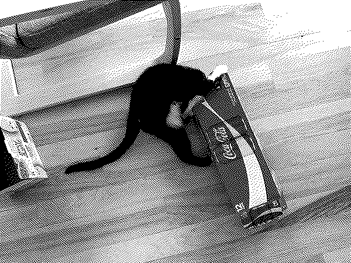
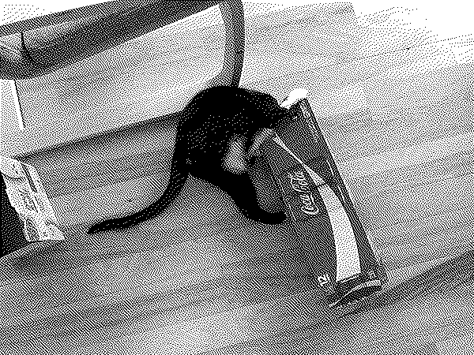

# Hyperdither.py

Simple Atkinson style dithering using Python.

To speed up the processing, this script requires numpy and numba. This fork has been updated both for modern Python programming standards (IE, Typehinting and Ruff formatting) and has been updated to function under Python 3.14.

## Example

Input image:

Command:

    hyperdither.py -1 cat.jpg

Output:

Reduced contrast:

    hyperdither.py -1 cat.jpg -c .85 -o cat_out2.png

## Options

- `-1`: 1-bit black and white file.  Otherwise the output is encoded as a grayscale file.
- `-t`: the black/white threshold.  Pixels at or above it become white.  The maximum is 255.
- `-d`: dpi out output file.  Only for printing purposes.  Default is 72 dpi.
- `-e`: output filetype.  Must be a format Pillow can write.  Default is png.
- `-o`: output path, instead of `<input>_out.<ext>`.  Its extension selects the format, so it cannot be combined with `-e`.
- `-f`: overwrite the output file if it exists.  Without it, an existing output file is left alone and the run stops.
- `-b`: start at bottom left instead of top left with the dithering.
- `-c`: boost contrast by specified amount (in terms of [pillow's][pillow] [ImageEnhancers][enhance] factor: 1 is no change).
- `-s`: boost sharpness by specified amount (in terms of [pillow's][pillow] [ImageEnhancers][enhance] factor: 1 is no change).
- `-g`: tone curve applied before dithering.  Numbers above 1 lighten the midtones, which helps printers that print dark.  Default is 1.
- `-r`: resize pre-dither image on longest dimension.  Makes the image smaller only, pre-dithering.
- `-2`: double post-dither image using nearest neighbors.  Makes output image twice as large as the pre-dither image.  If image is scaled from the resized pre-dither image if the `-r` option was specified.

For contrast and sharpness, 1 is default and does not need to be specified.  Numbers larger than 1 increase sharpness/contrast, numbers below 1 reduce it.  Negative numbers for contrast invert the image, for example `-c -1`.

I found values of 0.8 to 1.2 are good for contrast if you want lighten or darken specific areas.

## Printing on a dot-matrix printer

`--print` sends the image straight to an Epson-compatible (ESC/P) printer, one dot per dot, instead of writing a file.  It prints in one direction so graphics stay aligned.  The default is a 9-pin printer at 120x72 dpi.  Use `--pins 24` for a 24-pin printer at 180x180 dpi.  `--page-width` sets the printed width in inches, 8 by default.

On Linux, with the printer on a parallel port or USB adapter:

    sudo usermod -aG lp "$USER"
    uv run hyperdither.py photo.jpg --print /dev/usb/lp0

Log in again after the first command.  A parallel port is usually `/dev/lp0`.  Through a raw CUPS queue:

    uv run hyperdither.py photo.jpg --print - | lp -d QUEUE -o raw

If the device is reported as a regular file, something wrote to that path while no printer was attached, and output sent there never reaches paper.  Remove it with `sudo rm`, reconnect the printer, and check that `ls -l` shows a line starting with `c`.

Do not print a dithered PNG through a normal printer driver.  A driver rescales it, and rescaling destroys the dither.

Every printer and ribbon renders grays differently, so print the test wedge once:

    uv run hyperdither.py images/wedge.png --print /dev/usb/lp0

The 17 steps should get evenly lighter from left to right.  If the middle looks too dark, raise `-g`, for example `-g 1.4`.  If it looks too light, lower it.  Use the same `-g` value for your photos.

## Requirements

- [pillow][] 
- [numpy](http://www.numpy.org)
- [numba][]

Dependencies are declared in `pyproject.toml`.  With [uv](https://docs.astral.sh/uv/), run `uv run hyperdither.py -1 cat.jpg`, and `uv run pytest` for the tests.

[numba]: http://numba.pydata.org 
[pillow]: http://python-pillow.org
[enhance]: https://pillow.readthedocs.io/en/4.0.x/reference/ImageEnhance.html

## Links

- <http://www.tannerhelland.com/4660/dithering-eleven-algorithms-source-code/>
- <https://en.wikipedia.org/wiki/Bill_Atkinson>
